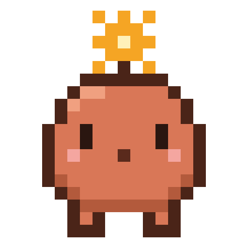

<p align="center"></p>

# Pixel-Buddy

Ein kleines Desktop-Figürchen für [Claude Code](https://claude.com/claude-code) unter Windows.
Es sitzt unten rechts über der Taskleiste. Wenn Claude um Erlaubnis fragt, zeigt es die Frage als
Sprechblase und du klickst einfach **Erlauben**, **Immer** oder **Nein**. Ein Wechsel ins
Chatfenster ist nicht nötig.

```
┌─────────────────────────────────────┐
│ mein-projekt                        │
│ möchte einen Befehl ausführen       │
│ ┌─────────────────────────────────┐ │
│ │ npm install && npm run build    │ │
│ └─────────────────────────────────┘ │
│ [ Erlauben ]  [ Immer ]  [ Nein ]   │
│ Im Chat entscheiden      noch 117 s │
└─────────────────────────────────────┘
                                   !
                                 (•ᴗ•)
```

## Was er macht

- **Startet mit Claude:** Sobald eine Claude-Code-Session beginnt, erscheint der Buddy, falls er noch nicht läuft.
- **Berechtigungsfragen als Sprechblase:**
  - **Erlauben** erlaubt die Aktion einmal.
  - **Immer** übernimmt Claudes vorgeschlagene Regel, damit Claude bei gleichen Aktionen nicht mehr fragt.
  - **Nein** lehnt ab.
  - **Im Chat entscheiden** schickt die Frage normal in den Chat. Das passiert auch nach 120 Sekunden ohne Klick.
- **Meldet, wenn Claude fertig ist:** Eine kurze Blase mit dem Projektnamen.
- **Hat Launen:**
  - wippt und blinzelt
  - schläft nach einer Minute Ruhe ein (Zz)
  - wird bei einer Frage mit „!“ wach
  - freut sich, wenn du etwas erlaubst
- **Stiehlt nie den Fokus:** Ein versehentliches Enter beim Tippen bestätigt nichts.
- **Verschiebbar:** Du kannst ihn per Maus ziehen, die Position merkt er sich. Per Rechtsklick kommt er „Zurück in die Ecke“, dort lässt er sich auch beenden.
- **Bleibt bei Rückfragen außen vor:** Rückfragen an dich (`AskUserQuestion`) und Pläne (`ExitPlanMode`) bleiben im Chat, weil dort deine Antwort gebraucht wird.

## Voraussetzungen

- Windows 10 oder 11
- [PowerShell 7](https://aka.ms/powershell) (`pwsh.exe` im PATH)
- Claude Code mit Unterstützung für Hook-Module (Mods)

## Installation

In einer Claude-Code-Session im Terminal:

```
/plugin install pixel-buddy --marketplace ValeWFun/pixel-buddy
```

Die Frage zum Marketplace beantwortest du mit `y`, dann wählst du einen Bereich (am besten „user“).

Aus einer Shell:

```bash
claude plugin install pixel-buddy --marketplace ValeWFun/pixel-buddy
```

In der Claude-Desktop-App: Klick auf **+** neben dem Eingabefeld, dann **Plugins**, dann **Add marketplace**
mit `ValeWFun/pixel-buddy` und danach **Add plugin**.

## So funktioniert es

| Teil | Aufgabe |
| --- | --- |
| `hooks/register.ts` | Das Hook-Modul. Es startet den Buddy bei `session.start`, gibt jede `PermissionRequest` an ihn weiter und wartet auf deine Antwort. Bei `Stop` meldet es „fertig“. |
| `buddy/hook.ps1` | Verbindet beide Seiten. Es fasst die Anfrage zusammen (Befehl, Datei, URL …), legt sie in die Warteschlange und gibt deine Antwort an Claude Code zurück. |
| `buddy/buddy.ps1` | Das Figürchen selbst: ein WinForms-Fenster mit Pixel-Sprite und Sprechblasen. |

Die beiden Seiten tauschen sich über Dateien in `%LOCALAPPDATA%\PixelBuddy\queue` aus. Dort liegen auch
das Log (`buddy.log`) und die gemerkte Position (`state.json`).

Wenn etwas schiefgeht (Buddy startet nicht, Fehler im Skript, keine Antwort), fällt die Frage immer
auf den normalen Dialog im Chat zurück. Es wird also nie etwas ohne dich erlaubt oder blockiert.

## Deinstallieren

```bash
claude plugin uninstall pixel-buddy
```

Danach den Buddy per Rechtsklick → **Buddy beenden** schließen und bei Bedarf den Ordner
`%LOCALAPPDATA%\PixelBuddy` löschen.

## Lizenz

MIT
